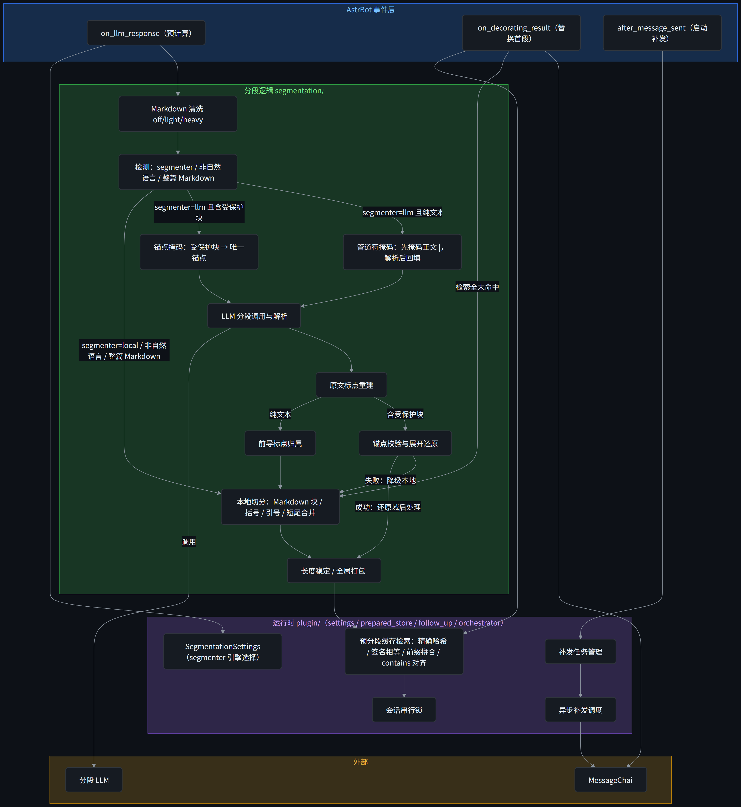

# AstrBot 智能分段插件 (个人维护版)

在主 LLM 回复生成后，由分段模型或本地切分引擎把完整回复拆成更像真人聊天的多条消息；发送前只保留首段，首段发送完成后再按延迟异步补发剩余段。

> ⚠️ **声明与背景（个人维护版）**
> 
> 本项目为原插件 [exynos967/astrbot_plugin_smart_segmentation](https://github.com/exynos967/astrbot_plugin_smart_segmentation) 的个人维护分支。
> 
> **深度优化适配本地轻量模型（如 Qwen3.5-4B-MTP Q4KXL）**：
> 在本地运行这类小参数模型时，通常会遇到指令遵循较弱、容易复读 Few-Shot 示例、以及推理 Token 消耗敏感等痛点。为此，本插件采用轻量级的管道符 `|` 分割协议与极简 Prompt（保留 3 条 Few-Shot 锁定格式），配合幻觉熔断与多级本地降级机制；同时内置完整的本地高精切分引擎（句子级分段、标点优先级、受保护块原子保护、短尾合并），发送引擎选 `local` 时完全不调用分段模型，零额外延迟。这使得该插件不仅能运行在云端大模型上，在本地轻量级模型下也能提供更稳定的运行表现。

## 特性

### 核心能力 (继承自原版)
- 使用 AstrBot 原生 hooks：`on_llm_response`、`on_decorating_result`、`after_message_sent`。
- 只处理 LLM/Agent 的纯文本结果，不改变图片、语音、文件等非文本消息链。
- 支持括号动作/神态描述独立成段，并避免整段动作文本被继续拆分。

## 个人维护版增强特性

**无需接入模型，支持本地切分**

- **发送引擎可选**：`local` 纯本地规则切分，零模型依赖、零额外延迟；`llm` 调用分段模型，分段边界更灵活，切分后仍保留全部保护规则。
- **句子级分段**：以完整句子为分段单元，段落由完整句子合并而成；单个句子超过单条上限时，才按「句末标点 > 分号 > 逗号」的优先级在标点处切开。
- **括号动作独立成段**：动作/神态括号固定独立成条，优先级高于其他切分规则。
- **省略号节奏**：「让我再想想……」这类停顿段独立成段（阈值可调）；句末标点或括号后的省略号归下一条开头，不会出现符号连排的段尾。
- **小模型稳定性**：针对本地小模型的格式崩溃与复读问题做了专门设计——轻量管道符协议、极简 Prompt（3 条 Few-Shot 锁定格式）、防复读检测；调用 LLM 分段失败自动降级至本地切分，不丢失信息。

**按结尾标点调整发送间隔，模拟真人节奏**

- **smart 发送延迟**：按上一条消息的结尾标点调整等待——省略号后多等、感叹号后急促，模拟真人说话节奏；触发符号、增减秒数与随机抖动全部可配置。

**代码/表格原子保护，切分行为可控**

- **复杂结构保护**：代码围栏、JSON、Markdown 表格/列表/引用、行内代码、链接/图片按优先级单遍隔离，块级原子不拆；正文里的 `|`（如 `cat | grep`）先替换为占位符、模型按 `|` 断句后再回填，不与分段协议冲突。
- **原文标点保留**：使用分段模型时以原文重建分段，确保原文标点与内容 100% 保留。
- **锚点分段**：消息中嵌入的受保护内容原位替换为唯一锚点后再调用分段模型，返回前还原——块内容不进入模型、永不被改写，任何异常自动回退本地切分。
- **切分行为自定义**：切分保护词（词前不断开）、强制切分符号（出现即分条）、末尾短消息并入上一条，全部可配置且默认关闭。
- 完整变更记录见 [CHANGELOG.md](CHANGELOG.md)。

## ⚠️ 风格兼容性声明（重要）
> ⚠️ **注意**：在开发与日常测试过程中，**维护者始终采用 `natural`（自然）分段风格**。由于未能对其他分段风格（如 `conservative` 或 `active`）进行充分的回归测试，并不确定切换风格后是否会产生意料之外的分段异常。**强烈建议保持使用 `natural` 风格以确保稳定性**。

## 配置说明（全局列表）

| 配置项 | 说明 | 默认值 |
| --- | --- | --- |
| `enabled` | 启用/禁用插件 | `true` |
| `segmenter` | 发送引擎：`local` 本地规则切分（零延迟、稳定），`llm` 调用分段模型 | `local` |
| `provider_id` | 分段模型 Provider ID，默认留空即使用当前会话模型；**推荐另外配置一个小模型（如本地轻量模型）专门用于分段**，避免占用主模型额度（仅 `llm`） | `""` |
| `style` | `natural` / `conservative` / `active`（仅 `llm`） | `natural` |
| `min_length` | 文本短于该长度不分段 | `10` |
| `max_segments` | 单次最多分段数量 | `12` |
| `max_chars_per_segment` | 单条消息最大字符数，超过后按标点二次拆分 | `180` |
| `markdown_clean_mode` | `off` / `light` / `heavy`；light 只清洗轻量标记并跳过重度结构，heavy 清洗全部 Markdown 标记 | `light` |
| `ellipsis_pause_min_chars` | 省略号停顿独立成段的最小长度（按字符数，`……` 计 2） | `4` |
| `temperature` | 分段模型温度（仅 `llm`） | `0.3` |
| `max_tokens` | 分段模型最大输出 token（仅 `llm`） | `600` |
| `timeout_seconds` | 分段模型超时时间（仅 `llm`） | `10.0` |
| `delay_base` | 补发基础延迟（秒） | `1.3` |
| `delay_per_char` | 按字符增加的延迟（秒/字符） | `0.05` |
| `delay_max` | 每条消息最大发送延迟（秒）；`llm`/`smart` 的符号修正与抖动在其上叠加 | `2.0` |
| `delay_strategy` | 发送延迟策略：`linear` 只随字符数增加延迟；`smart` 由基础延迟、结尾标点与随机浮动共同决定 | `linear` |
| `jitter_max_seconds` | smart 策略的随机抖动上限（秒），0 为关闭 | `0.15` |
| `smart_delay_increase_symbols` | 上一段以这些符号结尾时多等一会（省略号 `...` 与 `……` 是两种符号；全半角自动等价） | `["……", "...", "...?"]` |
| `smart_delay_increase_seconds` | 每出现一次增加符号追加的秒数 | `0.25` |
| `smart_delay_decrease_symbols` | 上一段以这些符号结尾时等得更短（语气急促地连着说） | `["！", "？！", "！？"]` |
| `smart_delay_decrease_seconds` | 每出现一次减少符号缩短的秒数 | `0.25` |
| `merge_short_tail` | 末尾短消息（如「嗯。」「好。」）并入上一条一起发 | `false` |
| `short_tail_threshold` | 并入上一条的字数上限（仅在 `merge_short_tail` 开启时显示） | `2` |
| `no_split_around` | 切分保护词：切分点后紧跟这些词时不切开 | `[]` |
| `force_split_symbols` | 强制切分符号：消息里出现即分两条，符号留在前一条末尾 | `[]` |

> ℹ️ `use_local_only` 与 `segmenter_migrated` 为内部迁移键：`use_local_only` 已弃用并在界面隐藏，旧值升级后自动映射到 `segmenter`，行为不变；两个键在整个 1.x 保留，计划 2.0 再评估移除。

> 💡 **使用建议**：建议关闭 AstrBot 内置的 `platform_settings.segmented_reply.enable`，避免其与本插件产生重复分段。

> ⚠️ **平台限制（插件已知问题）**：`temperature` 与 `max_tokens` 依赖宿主 `Context.llm_generate` 的 kwargs 透传，AstrBot 的 `_prepare_chat_payload` 会丢弃这两个参数（按 provider 默认值发出）。属平台层缺陷，待宿主修复后自动生效；分段质量对这两个参数不敏感。`timeout_seconds` 与其余配置不受影响。
>
> ✅ **修复方案（推荐）**：该缺陷现可由配套插件 [**astrbot_plugin_astrbot_tweaks**](https://github.com/EVOL233awa/astrbot_plugin_astrbot_tweaks)（Astrbot Tweaks）修复。在 WebUI 中开启其 `llm_kwargs_passthrough` 开关（默认关闭）后，插件会在 provider 发送前把白名单内显式传入的参数（默认 `temperature`、`max_tokens`）重新写回请求，并覆盖 `custom_extra_body` 中的同名配置，使本插件的 `temperature` / `max_tokens` 真正生效；白名单可用 `llm_kwargs_allowlist` 扩展至 `top_p`、`reasoning_effort` 等同类参数。该插件不修改 AstrBot 本体源码，卸载或重载时自动恢复原始方法。若暂不安装该插件，本插件仍按 provider 默认值发送这两个参数。

## 架构说明

架构图如下，箭头表示调用/写入方向，不画返回方向：

- `on_llm_response` 只负责预计算，不发送消息。
- `on_decorating_result` 负责替换首段并登记补发，不直接发送剩余段。
- `after_message_sent` 在首段发送成功后启动剩余段异步补发。
- 缓存未命中时，`on_decorating_result` 会调用本地高精切分兜底。
- heavy 清洗使用内容保全式正则，保留链接 URL、行内代码与 JSON/代码块正文。
- 分段引擎按职责拆分为 `segmentation/` 包：`core`（基础判断、归一化、哈希）、`protection`（结构保护与安全转义）、`markdown_clean`（Markdown 清洗）、`boundary`（候选切点与括号边界）、`packing`（目标长度与打包约束）、`local_split`（本地切分编排）、`delivery`（发送延迟）、`model_output`（LLM 协议、解析与重建）、`anchor`（受保护块锚点掩码与还原）；`__init__.py` 作为公开 API 门面，导入路径保持不变。

## 技术实现与 AI 辅助说明

本项目的核心分段逻辑与优化策略（包含协议重构、幻觉阻断、Markdown 保护等）在编写与重构过程中，参考并使用了 AI 模型进行代码逻辑验证与优化建议。

- **免责声明**：虽然我已经对代码进行了多轮个人测试与场景验证，确保其在本地 Qwen3.5-4B-MTP Q4KXL 环境下的稳定性，但由于代码逻辑复杂，仍不能保证在所有大模型、所有上下文环境下绝对无偏差。使用本插件产生的任何意外输出或逻辑问题，请用户根据实际情况进行调试或反馈。
- **开源精神**：本项目旨在解决个人在本地小模型使用中的实际痛点。代码完全开源，欢迎开发者审查代码逻辑，提交 Issue 或 PR 共同完善。

## 测试

- 从插件根目录运行全部测试：`python -m unittest discover -s tests -v`
- 或用 pytest：`python -m pytest tests -q`
- 测试按模块分类，可单独运行某个模块：`python -m unittest tests.test_boundary -v`
  （模块文件：`test_core`、`test_protection`、`test_markdown_clean`、`test_boundary`、`test_packing`、`test_local_split`、`test_delivery`、`test_model_output`、`test_anchor`、`test_migration`、`test_main_concurrency`、`test_v140_alignment`）

## 许可证

GPL-3.0-or-later
