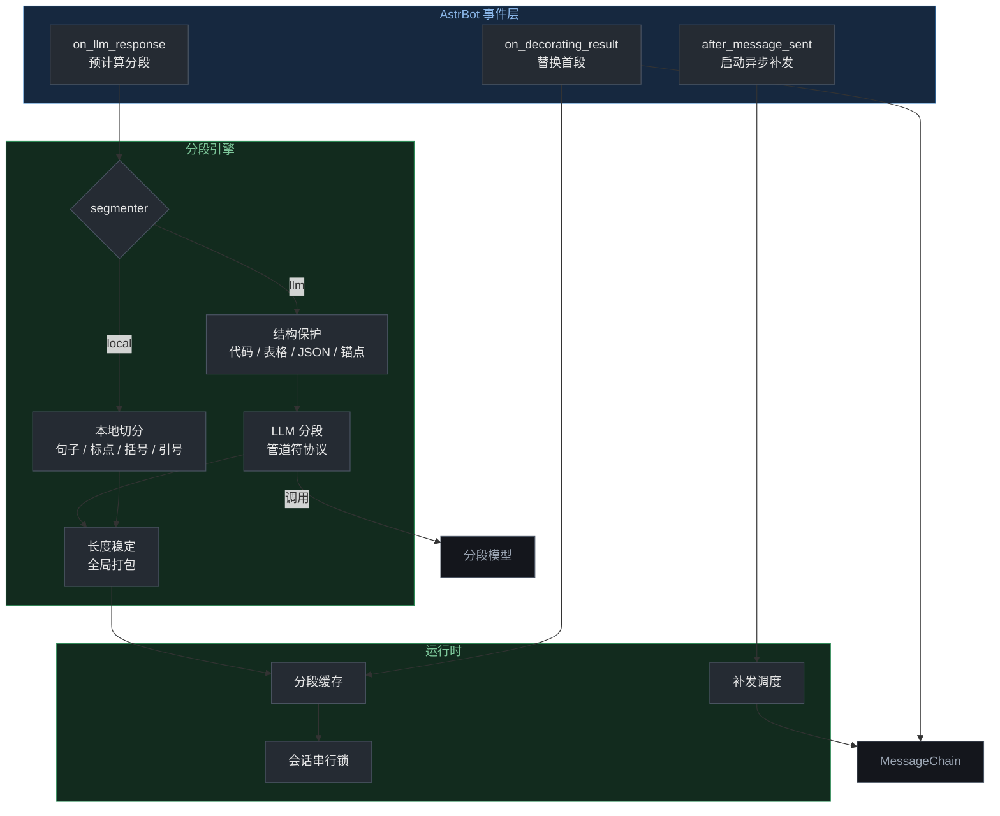

# 智能分段 增强版

AstrBot 插件：把 LLM 长回复拆成多条更像真人聊天的消息，支持纯本地切分。

`AstrBot >= 4.16,<5` · `v1.5.8` · `GPL-3.0-or-later`

> 安装：WebUI → 插件市场搜索「智能分段 增强版」。

## 背景

本项目是 [exynos967/astrbot_plugin_smart_segmentation](https://github.com/exynos967/astrbot_plugin_smart_segmentation) 的个人维护分支，重点解决本地小模型的两个问题：指令遵循弱、容易复读 Few-Shot 示例，以及推理 token 敏感。

- 分段协议使用轻量管道符 `|`，Prompt 只保留 3 条 Few-Shot 锁定格式。
- 模型输出异常时熔断，自动降级到本地切分。
- 内置本地切分引擎；`segmenter=local` 时不调用分段模型。

## 特性

**处理范围**

- 只处理 LLM/Agent 的纯文本结果；图片、语音、文件等非文本消息链原样通过。
- 括号动作/神态可独立成段，且不会被继续拆分。

**两种发送引擎**

| 引擎 | 行为 | 适用 |
|---|---|---|
| `local` | 本地规则切分，不调用模型，无模型等待 | 默认；本地小模型、不想多耗 token |
| `llm` | 调用分段模型，断句更灵活；失败自动降级 `local` | 云端模型、追求更自然的聊天节奏 |

**本地切分**

- 以完整句子为分段单元；单句超过单条上限时，才按「句末标点 > 分号 > 逗号」切开。
- 括号动作固定独立成条；省略号停顿可独立成段，阈值可调。
- 末尾一两个字的短消息可并入上一条，避免碎消息。

**结构保护**

- 代码围栏、JSON、Markdown 表格/列表/引用、行内代码、链接/图片按优先级整体保护，不拆块。
- 正文里的 `|` 先替换为占位符，解析后回填，不与分段协议冲突。
- 使用 `llm` 时，受保护块替换为锚点，块内容不进入模型；返回后按原文重建，避免标点被改写。

**发送节奏**

- `linear`：延迟随字符数增加。
- `smart`：按上一段结尾标点增减等待（省略号多等、感叹号后急促），可加随机抖动。
- 同一会话来了新消息时，上一条回复剩余的分段会快速发出，追问的回复不必等旧消息按原节奏排完；加速间隔可在配置中调整或关闭该行为。
- 官方 QQ、微信公众号与钉钉平台的主动消息受配额或接口限制，默认整条发出；QQ 官方（非 webhook）在 AstrBot 4.20.0 及以上可开启 `qq_official_follow_up` 分段补发。

## 架构



- `on_llm_response` 只做预计算，不发送消息。
- `on_decorating_result` 替换首段并登记补发，不直接发送剩余段。
- `after_message_sent` 在首段发送成功后启动异步补发。
- 缓存未命中、模型超时或输出异常时，走本地切分兜底。

## 安装与配置

### 安装

1. 确认 AstrBot 版本满足 `>=4.16,<5`。
2. 推荐：WebUI → 插件市场，搜索「智能分段 增强版」并安装。
3. 手动安装：

   ```bash
   git clone https://github.com/EVOL233awa/astrbot_plugin_smart_segmentation_enhanced \
     AstrBot/data/plugins/astrbot_plugin_smart_segmentation_enhanced
   ```

   重启或重载 AstrBot。
4. AstrBot 会按 `requirements.txt` 自动安装 `markdown-it-py` 与 `mdit-plain`。
5. 打开插件配置，保持 `segmenter=local` 即可使用，不需要额外模型。

> 建议关闭 AstrBot 内置的 `platform_settings.segmented_reply.enable`，避免重复分段。

### 常用配置

| 配置项 | 说明 | 默认值 |
|---|---|---|
| `enabled` | 启用插件 | `true` |
| `strip_thinking_tags` | 删除代码块外的 `<thinking>…</thinking>` 整段；4.29.0 之前需要，4.29.0 起可关闭 | `true` |
| `qq_official_follow_up` | QQ 官方平台是否补发剩余分段；4.20.0 之前开启会丢分段 | `false` |
| `segmenter` | 发送引擎：`local` / `llm` | `local` |
| `provider_id` | 分段模型 Provider；留空使用当前会话模型（仅 `llm`） | `""` |
| `style` | 分段风格：`natural` / `conservative` / `active`（仅 `llm`） | `natural` |
| `max_segments` | 单次最多分段数 | `12` |
| `max_chars_per_segment` | 单条消息最大字符数，超出后按标点二次拆分 | `180` |
| `delay_strategy` | 发送延迟：`linear` / `smart` | `linear` |
| `merge_short_tail` | 末尾短消息并入上一条 | `false` |
| `fast_forward_enabled` | 同会话新消息时，旧回复剩余分段加速收尾 | `true` |
| `fast_forward_delay` | 加速收尾的发送间隔（秒，开关打开时显示） | `0.2` |

完整配置（保护词、强制切分符号、smart 延迟符号等）见 WebUI 配置页或 `_conf_schema.json`。

## 行为与已知限制

- **风格**：维护与测试主要使用 `natural`；`conservative` / `active` 未做充分回归，建议保持 `natural`。
- **宿主限制**：当前 AstrBot 的 `_prepare_chat_payload` 会丢弃 `temperature` 与 `max_tokens`，这两个配置暂不生效。可安装配套插件 [astrbot_plugin_astrbot_tweaks](https://github.com/EVOL233awa/astrbot_plugin_astrbot_tweaks)，开启 `llm_kwargs_passthrough` 修复；分段质量对这两个参数不敏感。
- **模型失败**：`llm` 模式超时后跳过本次分段，直接发送原回复；其他异常自动降级本地切分。
- **段数与单条长度**：回复总长超过 `max_segments × max_chars_per_segment` 时优先保证段数上限，单条可能超过 `max_chars_per_segment`。
- **重复分段**：与 AstrBot 内置分段同时开启会重复拆条，建议只保留一个。
- **测试范围**：主要在本地 Qwen3.5-4B-MTP Q4KXL 环境验证，其他模型/上下文可能有差异。

## 测试

```bash
python -m unittest discover -s tests -v
# 或
python -m pytest tests -q
```

单模块：`python -m unittest tests.test_boundary -v`。

## 开发说明

核心分段逻辑在 AI 辅助下重构与验证；问题与改进请提交 Issue 或 PR。

## 参考

本项目的部分能力在设计与行为预期上参考了社区分段插件，实现均为独立编写，未复制参考项目的代码、注释或文档文案。

| 能力 | 参考来源 |
| --- | --- |
| 标点优先切分 | [Zhalslar/astrbot_plugin_outputpro](https://github.com/Zhalslar/astrbot_plugin_outputpro) |
| 短尾合并 | [LinJohn8/astrbot_plugin_custome_segment_reply](https://github.com/LinJohn8/astrbot_plugin_custome_segment_reply) |
| 保护词 | [nuomicici/astrbot_plugin_splitter](https://github.com/nuomicici/astrbot_plugin_splitter)、[LinJohn8/astrbot_plugin_custome_segment_reply](https://github.com/LinJohn8/astrbot_plugin_custome_segment_reply) |
| 强制切分符号 | [LinJohn8/astrbot_plugin_custome_segment_reply](https://github.com/LinJohn8/astrbot_plugin_custome_segment_reply) |
| smart 延迟 | [Zhalslar/astrbot_plugin_outputpro](https://github.com/Zhalslar/astrbot_plugin_outputpro)、[LinJohn8/astrbot_plugin_custome_segment_reply](https://github.com/LinJohn8/astrbot_plugin_custome_segment_reply)、[nuomicici/astrbot_plugin_splitter](https://github.com/nuomicici/astrbot_plugin_splitter) |

## 许可证

GPL-3.0-or-later。见 [LICENSE](LICENSE)。
